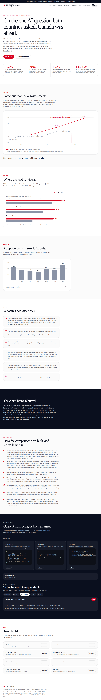
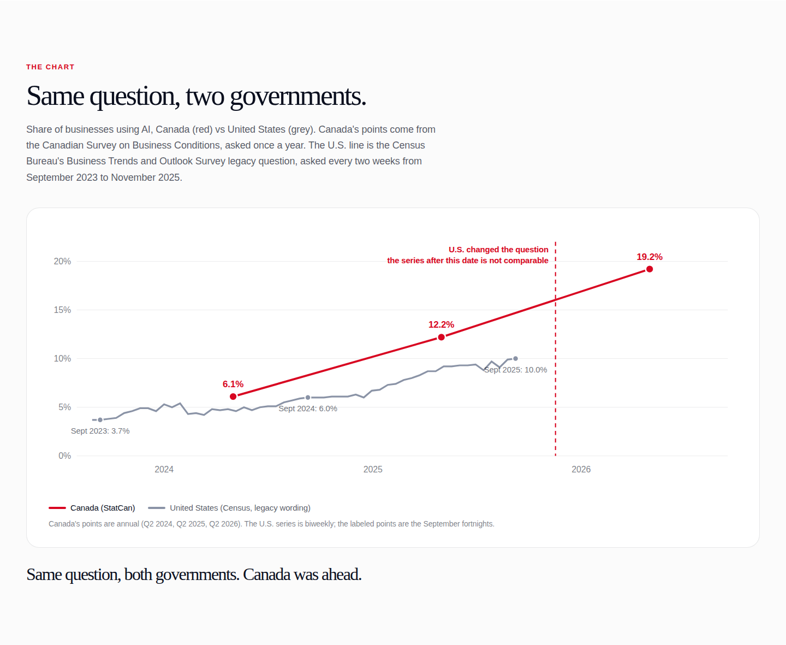

# The Adoption Inversion

On the one AI-adoption survey question Canada and the US asked businesses in nearly identical words, which country is actually ahead? In 2025 the answers were **12.2% in Canada** (Statistics Canada, Q2 2025) and **10.0% in the United States** (U.S. Census Bureau BTOS, September 2025, legacy wording). This page charts the two official series, documents exactly how they were harmonized, and marks where the comparison stops being honest.

Live URL: https://adoption.canada.nshipyard.com (deploy pending)

An Open Nshipyard project. Open source, MIT licensed. Not affiliated with the Government of Canada or the U.S. Census Bureau.

## Screenshots

### Desktop (EN)


### Mobile (EN)


### Desktop (FR)


### Hero chart


## The data

Every U.S. figure on this page was pulled from the Census Bureau's own files on 2026-10-09 and cross-checked against the spec's curated-dataset figures. They matched exactly:

- **Sept 2023: 3.7%** (fortnight 202320), **Sept 2024: 6.0%** (fortnight 202420), **Sept 2025: 10.0%** (fortnight 202520), national "Yes" shares on the legacy question "used AI in producing goods or services", from the Census "AI Core Questions" file (original wording series).
- The Census changed the question on **November 17, 2025** ("in any of its business functions") and started a new time series December 4, 2025. Only pre-break fortnights are used. Post-break values circulating in curated datasets were not verified against Census files and are not charted.
- Canada: 12.2% Q2 2025 (6.1% Q2 2024), 19.2% Q2 2026, from Statistics Canada's Canadian Survey on Business Conditions (analytical publications 11-621-m2025008 and 11-621-m2026010; the publication cites CSBC Table 33-10-1004-01).
- Sector comparison (2025): information 35.6% vs 29.3%, professional/scientific/technical 31.7% vs 23.9%, finance and insurance 30.6% vs 17.1% (Canada Q2 2025 vs US Sept 2025 fortnight).

### Honest caveats (also on the page)

- **Reference windows differ**: StatCan asks about the 12 months preceding the survey; BTOS asks about the last two weeks. A 12-month window mechanically raises the yes share, so part of Canada's lead reflects the window, not just adoption.
- Firm-size cuts: StatCan publishes them in Table 33-10-1005, which was not retrievable at build time (the StatCan bulk CSV download served stale content for this cube), so the firm-size panel is U.S.-only.
- Both surveys weight by firm count, not employment; Canada's SME-heavy economy (SMEs employ ~64% of private-sector workers, ISED) mechanically depresses firm-count-weighted adoption.

## Data sources

- Statistics Canada, Canadian Survey on Business Conditions: https://www150.statcan.gc.ca/n1/pub/11-621-m/11-621-m2025008-eng.htm and https://www150.statcan.gc.ca/n1/pub/11-621-m/11-621-m2026010-eng.htm
- U.S. Census Bureau, Business Trends and Outlook Survey downloads: https://www.census.gov/hfp/btos/downloads/ (AI Core Questions file, legacy wording series; question-change notice "AI Question Wording Updates", December 3, 2025)
- SME employment share: ISED, Key Small Business Statistics 2024

## Methodology summary

1. Pull the Census AI Core Questions file; extract national "Yes" (Question 7, Answer 1) for all fortnights; label the September reference points.
2. Transcribe StatCan headline and sector figures from the analytical publications (the bulk CSV download served stale content for this cube; transcription double-checked against the publication).
3. Map sectors: StatCan "information and cultural industries" to BTOS NAICS 51; "finance and insurance" to NAICS 52; "professional, scientific and technical services" to NAICS 54. Documented, not adjusted.
4. Chart only pre-November-2025 U.S. fortnights; draw the break line; never splice post-break values.
5. Quarterly updates: re-pull both sources, append the new points, re-verify September labels; if the Census changes wording again, freeze and draw a new break.

Full methodology with the update procedure is on the site's Methodology section. Reproducible pipeline: `scripts/build_data.py` (reads `scripts/sources/btos_ai_core.xlsx`, writes `public/data/`).

## API

- `GET /api/v1/series` — harmonized series
- `GET /api/v1/sectors` — sector comparison
- `GET /api/v1/meta` — headline, caveat, sources
- `GET /api/openapi.json` — OpenAPI 3.1 spec
- `POST /mcp` — MCP server (streamable HTTP): `series_lookup`, `sector_comparison`, `firmsize_us`, `coverage`

## Development

```bash
npm install
npm run dev      # http://localhost:3000
npm run build    # production build
```

## Built by

**Richardson Dackam** — https://x.com/richardsondx — https://github.com/richardsondx
